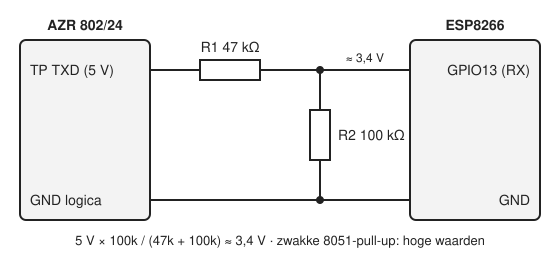

# flipdot-ret-mqtt

> [!WARNING]
> De uitbreidingen in deze versie (WiFiManager, testbeelden en terugkoppeling) zijn geschreven door een AI-tool (Claude Code).
> Op echte hardware getest (17 november 2026, ASFP-bitmap 6 MHz op 15625 baud, display met 3 modules): tekst, testbeelden,
> WiFiManager, baudrate, terugkoppeling (`a0`, versie, online/offline), pixels en bitmaps werken.
>
> De oude versie, die gegarandeerd werkt (alleen MQTT-tekst, vaste WiFi-instellingen), staat hier:
> [commit 516d74e](https://github.com/sebastius/flipdot-ret-mqtt/tree/516d74efc74584d3be5404fb560bb7d9deb0702e).

ESP8266-firmware (NodeMCU) die MQTT-berichten als IBIS-telegram naar een LAWO-flipdotdisplay (AZR 802/24 met ASFP-firmware) stuurt.
Achtergrond over de controller staat in [sebastius/lawo-flipdot](https://github.com/sebastius/lawo-flipdot).

## MQTT

| Topic | Richting | Inhoud |
|---|---|---|
| `<topic>` (standaard `revspace/flipdot`) | naar het display | tekst. Regels scheid je met `\n`. Na een pagina van twee regels volgt `\n\n`, na een pagina van één regel `\n\n\n`. Anders valt het eerste teken van de volgende pagina weg (getest in de [emulator](https://sebastius.github.io/lawo-flipdot/emulator/web/)). Eén regel krijgt het grote font als hij past, twee regels het kleine. |
| `<topic>/test` | naar het display | testbeeld: `0` zwart, `1` geel, `2` dambord, `3` omgekeerd dambord |
| `<topic>/query` | naar het display | `status` of `version`. Diagnose (antwoord op `<debugtopic>/raw`): `rx` (aantal ontvangen bytes en de laatste 16), `loop` (interne UART-lus), `level` (niveau van GPIO13), `probe` (flanken en intervallen op GPIO13 tijdens een versievraag), `uart` (UART-registers) |
| `<topic>/raw` | naar het display | ruw telegram zonder CR/checksum, bijvoorbeeld `aV1` |
| `<topic>/pixel` | naar het display ¹ | `x,y,c` (c = `0` zwart / `1` geel, y = 0 is boven). Meerdere pixels scheid je met `;`, een spatie of een regeleinde. |
| `<topic>/bitmap` | naar het display ¹ | hex, 4 tekens per kolom (bit y = rij y van boven); optioneel `XXX:` als startkolom. 84 kolommen = 336 hex-tekens. |
| `<topic>/refresh` | naar het display ¹ | alle dots opnieuw omzetten (tegen vastzittende dots) |
| `<debugtopic>` (standaard `revdebug/flipdot`) | van de ESP | `hello world` bij het verbinden |
| `<debugtopic>/ack` | van de ESP | `ok` of `timeout` per telegram dat een antwoord verwacht |
| `<debugtopic>/display` | van de ESP | `online` / `offline` (retained); wordt elke 60 s opgevraagd |
| `<debugtopic>/version` | van de ESP | versie van de displayfirmware, bijvoorbeeld `F00293` (retained) |
| `<debugtopic>/config` | van de ESP | huidige baudrate, adres, topic en IP-adres (retained) |
| `<debugtopic>/raw` | van de ESP | onbekende antwoorden en meldingen |

¹ Werkt alleen met de [ASFP-bitmap-firmware](https://github.com/sebastius/lawo-flipdot/tree/main/firmware-patches/asfp-bitmap).
Die telt standaard 28 op bij x, omdat het geteste display de eerste module mist: x = 0 is de eerste zichtbare kolom
en x loopt tot 83. Elke pixel- of bitmapupdate kost op het display tot ongeveer 0,7 s rekenwerk; stuur veel pixels liever
in één bericht dan in veel losse berichten, anders raakt de wachtrij in de controller vol en gaan er berichten verloren.
Lange pixel- en bitmapberichten verstuurt de ESP vanzelf in stukken van hooguit 500 tekens.

Teksten langer dan 238 tekens worden afgekapt. ASFP negeert een telegram van meer dan ongeveer 249 tekens zonder melding.

**Wachtrij:** alle telegrammen gaan via een wachtrij van 16 plaatsen. De ESP verstuurt het volgende telegram pas na het
antwoord (`a0`) op het vorige. Komt er geen antwoord, bijvoorbeeld omdat de antwoordlijn niet is aangesloten, dan gaat hij
na een korte time-out toch door. Dat is nodig voor de snelle firmwares.

## Baudrate

Stel in de webinterface (*Setup*) de baudrate in die bij de firmware van de controller hoort:

| Firmware in de controller | Baudrate |
|---|---|
| originele ASFP (6 MHz, IBIS) | `1200` (standaard) |
| ASFP-bitmap 6 MHz | `15625` |
| ASFP-bitmap 12 MHz | `31250` |

De nieuwe baudrate gaat direct in, zonder herstart.

## Instellen (WiFiManager)

- **Zonder werkende WiFi** start de ESP een access point `Flipdot-XXXXXX` (het display toont de naam). Verbind ermee en open 192.168.4.1.
- **Met WiFi** is dezelfde instellingenpagina bereikbaar op het IP-adres dat bij het opstarten op het display verschijnt, via menu *Setup*.
- Instelbaar: MQTT-server, poort, luistertopic, debugtopic, het IBIS-displayadres (1–15) en de baudrate. De instellingen worden opgeslagen in LittleFS (`/config.json`).

## Aansluiting

De ESP hangt direct aan de 80C31 op de AZR 802/24. De IBIS-businterface (optocoupler en inverter) wordt niet gebruikt.



- **ESP TX = GPIO15 (D8)** (na `Serial.swap()`), 7E2 op de ingestelde baudrate, **direct naar P3.0/RXD (pin 10)** van de 80C31.
  **Let op bij het opstarten:** GPIO15 moet laag zijn als de ESP start, anders start hij niet uit zijn flash. De RXD-pin
  van de 80C31 trekt de lijn omhoog, zeker tijdens een reset van de controller. Gaan ESP en controller tegelijk aan, dan
  blijft de ESP soms hangen (geen "Booting...", geen WiFi); een druk op RST van de ESP helpt. Een serieweerstand van
  ongeveer 1–2,2 kΩ in deze lijn, of de ESP pas na de controller laten starten, voorkomt het (nog niet getest).
  De uitgang van de 74HC14 (IC1A) die normaal RXD aanstuurt, is losgekoppeld, anders vechten de twee om die lijn.
  3,3 V is genoeg, want de 80C31 ziet een spanning boven ongeveer 1,9 V als "hoog".
- **Terugkoppeling (optioneel):** ESP RX = GPIO13 aan **P3.1/TXD (pin 11)**, oftewel testpunt TP TXD, **via een spanningsdeler naar 3,3 V**.
  Zonder deze verbinding meldt de ESP het display als `offline` en elke tekst als `timeout`; het display zelf werkt dan gewoon.

  **Interne pull-up uit:** de ESP8266-core zet bij `Serial.swap()` de interne pull-up van GPIO13 aan. Samen met de deler
  trekt die het "laag" van TXD op tot ongeveer 1,3 V, en dan ontvangt de UART niets. De firmware zet de pull-up daarom
  weer uit (`rxNoPullup()`). Wie zelf code schrijft: let hierop, of gebruik kleinere weerstanden.

  De ESP8266 kan niet tegen 5 V. De logica van de controller werkt op 5 V. R1/R2 brengen het hoge niveau terug naar ongeveer 3,4 V.
  De weerstanden zijn bewust hoog gekozen, omdat de TXD-pin van de 80C31 een "hoog" maar zwak vasthoudt (enkele tientallen µA).
  De massa van de ESP gaat naar de logische massa van de controller, niet naar de geïsoleerde IBIS-kant.
  Een BSS138-niveauomzetter mag ook.
- Schakelaar S2 op de controller moet in de stand staan waarin de seriële ontvangst aan staat. S1 bepaalt of ASFP tekst automatisch omzet naar Hoofdletter-aan-het-begin.

## Bouwen

```sh
pio run -t upload
```

If you want a license: MIT License
